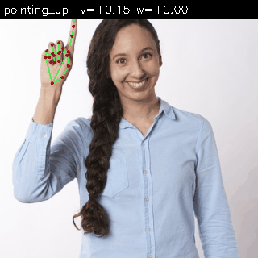
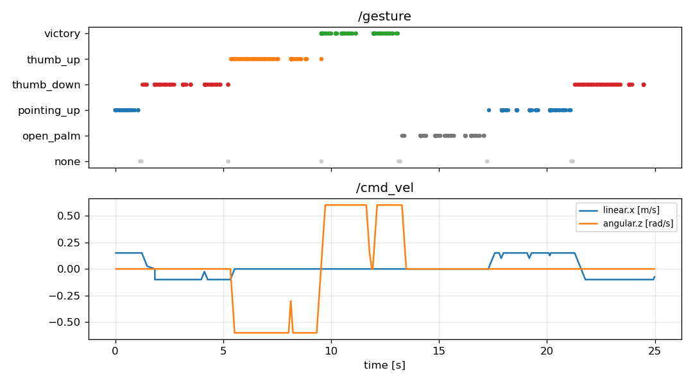
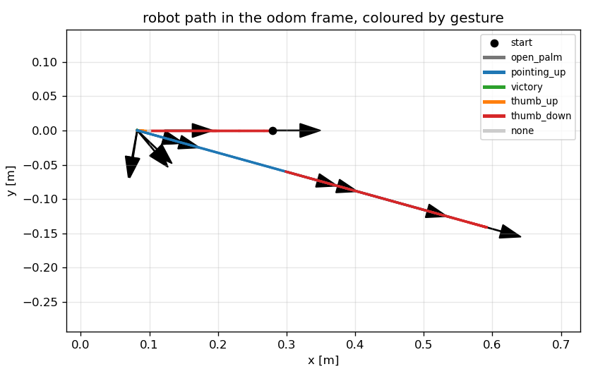

# Gesture Controlled Robot (ROS 2 Jazzy)

Drive a TurtleBot3 in Gazebo Harmonic with hand gestures from a webcam.

```
usb_cam -> hand_landmarker_node -> gesture_classifier_node -> gesture_to_cmd_vel_node -> /cmd_vel -> TurtleBot3
            (MediaPipe Tasks)      (MediaPipe GestureRecognizer     (deadman, ramp, clamp)
                                    or custom Keras 3 -> LiteRT)
```

**Stack:** ROS 2 Jazzy Jalisco (LTS), Gazebo Harmonic, TurtleBot3 burger, MediaPipe Tasks `HandLandmarker`,
Keras 3 training -> `.tflite` inference with LiteRT (`ai-edge-litert`), OpenCV, Docker devcontainer.
Runs on x86_64 and arm64 (mediapipe 1.x has wheels for both).

See [docs/PLAN.md](docs/PLAN.md) for the design, work plan and reasoning, and
[docs/ARCHITECTURE.md](docs/ARCHITECTURE.md) for the node and topic layout.

## Demo (headless, still images driving the robot in Gazebo)



| gesture timeline and resulting /cmd_vel | robot path in Gazebo |
|---|---|
|  |  |

Recorded on a 2 vCPU arm64 VM with no display and no camera: the test images in
`src/gesture_recognition/test/images` are cycled onto `/image_raw`, the landmarker and
classifier turn them into `/gesture`, and the control node drives the TurtleBot3 in a
server-only Gazebo. These figures come from `recognizer:=custom`, the trained seed
classifier; the MediaPipe recognizer gives the same sequence. Reproduce with:

```bash
scripts/demo_headless.sh                      # writes docs/demo/*
RECOGNIZER=custom scripts/demo_headless.sh    # same, with the trained .tflite
```

## Quick start (Docker)

```bash
scripts/download_models.sh                 # fetch MediaPipe .task models (not in git)
docker compose -f docker/docker-compose.yml build
docker compose -f docker/docker-compose.yml run --rm dev     # headless shell
# inside the container:
colcon build --symlink-install && source install/setup.bash
pytest                                     # unit tests + launch tests
scripts/headless_smoke_test.sh             # server-only Gazebo, robot must move
```

On a machine with a display and webcam:

```bash
xhost +local:docker
docker compose -f docker/docker-compose.yml run --rm demo
ros2 launch gesture_control bringup.launch.py recognizer:=mediapipe   # or recognizer:=custom
ros2 run rqt_image_view rqt_image_view /hand/image_annotated           # optional overlay
```

Useful launch arguments for `bringup.launch.py`: `sim:=false` (real robot), `headless:=true`
(no Gazebo client), `source:=images images:=<dir>` (no camera), `recognizer:=mediapipe|custom`.

## Training your own classifier

```bash
python3 -m venv .venv && . .venv/bin/activate && pip install -r ml/requirements-train.txt
python3 ml/collect_data.py --out ml/data/me.csv            # webcam, keys 0-5 label frames
python3 ml/collect_data.py --out ml/data/stills.csv --images photos/ --augment 20
python3 ml/train.py ml/data/*.csv                           # writes models/gesture_mlp.tflite
python3 ml/evaluate.py ml/data/holdout.csv                  # LiteRT, same runtime as the node
```

The committed `gesture_mlp.tflite` is a seed model trained only on augmented copies of the
five test images, each run through the landmarker in video mode so the training landmarks
match what the nodes see. It proves the export and LiteRT path; collect real webcam data
before relying on it.

## Gesture map

| Label | Action | linear.x | angular.z |
|---|---|---|---|
| open_palm, fist | stop | 0 | 0 |
| pointing_up | forward | 0.15 | 0 |
| victory | turn left | 0 | 0.6 |
| thumb_up | turn right | 0 | -0.6 |
| thumb_down | reverse | -0.10 | 0 |

Edit `src/gesture_control/config/gesture_map.yaml` to change it. The control node zeroes the
command 0.5 s after the last gesture, ramps with an acceleration limit and clamps to the
burger's limits.

## Status

Verified on an arm64 VM and in CI (x86_64): build, 13 unit and launch tests, the recognition
launch test with both recognizers, the headless Gazebo smoke test, and the still-image demo
above with both recognizers. Still to do with a webcam
and a display: a fist image fixture, a real training set, threshold tuning on live frames and
the Gazebo GUI recording.

## Native install (Ubuntu 24.04)

```bash
sudo apt install ros-jazzy-desktop-full ros-jazzy-turtlebot3-gazebo ros-jazzy-turtlebot3-teleop \
                 ros-jazzy-usb-cam ros-jazzy-cv-bridge ros-jazzy-twist-mux python3-colcon-common-extensions
pip install -r requirements.txt --break-system-packages
```

## Why Jazzy and not Lyrical?

Lyrical Luth (May 2026) is the newest LTS but targets Ubuntu 26.04, and TurtleBot3 has no Lyrical release yet.
Jazzy is LTS until May 2029, runs natively on Ubuntu 24.04, and has TurtleBot3 2.3.x packages. Migrating later
means changing the Docker base image and apt prefix; the nodes themselves are plain rclpy.
